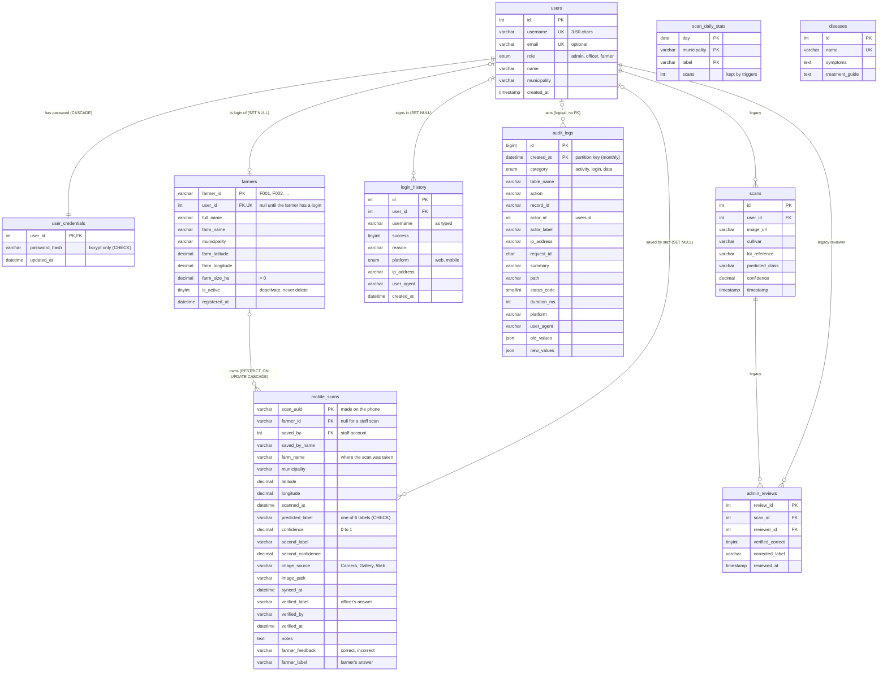

# PinePal database: entity relationship diagram

The MySQL database `pinepal_db` (Aiven, MySQL 8.4), as it is live on 2026-11-17.
GitHub draws the diagram below. To open it elsewhere, paste the `mermaid` block into
[mermaid.live](https://mermaid.live), or reverse-engineer the live database in MySQL Workbench
(Database > Reverse Engineer).

Solid lines are enforced foreign keys. The dotted line is a logical link with no foreign key:
`audit_logs` is partitioned by month, and MySQL does not allow foreign keys on partitioned tables.

## Relationships

| From | To | Cardinality | On delete | Why |
| --- | --- | --- | --- | --- |
| `user_credentials.user_id` | `users.id` | 1 : 1 | CASCADE | The password hash is split from `users` (vertical partition), so pages that read users never carry it. |
| `farmers.user_id` | `users.id` | 0..1 : 0..1 (unique) | SET NULL | A farmer may have no login yet; removing a login keeps the farmer and their scans. |
| `mobile_scans.farmer_id` | `farmers.farmer_id` | 1 : many | RESTRICT, ON UPDATE CASCADE | A farmer with scans can't be deleted (deactivate instead). Null for a scan staff saved for no farmer. |
| `mobile_scans.saved_by` | `users.id` | 1 : many | SET NULL | Which staff account saved a web scan. |
| `login_history.user_id` | `users.id` | 1 : many | SET NULL | Sign-in history survives account deletion. |
| `audit_logs.actor_id` | `users.id` | 1 : many | none (logical) | Partitioned tables can't have foreign keys; the log must also outlive deleted accounts. |
| `scans`, `admin_reviews` | `users`, `scans` | 1 : many | NO ACTION | Legacy tables from the first version; not used by the current app. |

`diseases` and `scan_daily_stats` stand alone. Scan labels are limited to the six model labels
by CHECK constraints rather than a foreign key, and `scan_daily_stats` is a summary of
`mobile_scans` kept up to date by triggers.

## Normalization notes

The design is in third normal form apart from these deliberate copies:

- `mobile_scans.farm_name`, `municipality`, `latitude`, `longitude` record where the scan was
  taken. They are a snapshot at scan time, so they stay correct if the farm's details change later.
- `mobile_scans.saved_by_name` keeps the staff member's name on the scan if their account is removed.
- `users.municipality` mirrors `farmers.municipality` for farmer accounts, kept in step by the
  backend (`sync_user_municipality` in `backend/farmers.py`).
- `scan_daily_stats` is a derived summary table, maintained only by triggers, so dashboard totals
  don't count every scan.

Not shown: `mobile_scans_deleted_outside_echague` and `mobile_scans_municipality_backup`, one-off
copies made before bulk data clean-ups. They have no keys to other tables and the app can't read them.

Definitions: `backend/schema.sql` and the `backend/migrate_*.py` scripts.
